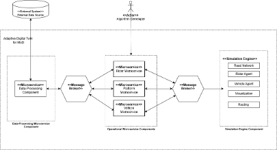
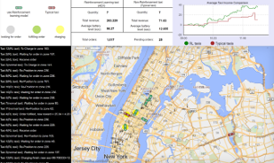

# Digital Twin Microservice Framework

> An **event-driven Mobility-on-Demand simulation backend** built with **Java 21, Spring Boot, and RabbitMQ**, separating demand, taxi decisions, fleet coordination, and simulation-engine integration into independently runnable services.

This project explores how a digital-twin simulation can keep agent execution outside the backend while delegating demand retrieval, fleet state, matching, taxi-operation sequencing, and monitoring to message-driven microservices. RabbitMQ forms the integration boundary between the Spring Boot services and an external AnyLogic simulation.

## 1. Technology Profile

| Area | Implementation |
| --- | --- |
| **Services** | Java 21 · Spring Boot 3.4 · non-web worker applications · dependency injection |
| **Messaging** | RabbitMQ · Spring AMQP · direct exchanges · durable queues · JSON payloads · correlation IDs |
| **Service boundaries** | Central Operator · Order Service · Taxi Service · standalone simulation adapter |
| **Concurrent state** | `ConcurrentHashMap` · `ConcurrentLinkedQueue` · `CopyOnWriteArrayList` |
| **Data processing** | Apache POI · historical trip workbook ingestion · generated matching/utility workbooks · analysis notebooks |
| **Simulation integration** | Request/response commands · asynchronous lifecycle events · [AnyLogic model](https://github.com/Matt1204/digital-twin-anyLogic) |

## 2. System Architecture



The repository contains three Spring Boot services and one Java integration client:

| Component | Responsibility |
| --- | --- |
| **Central Operator** | Owns current fleet/order state, simulation time, matching orchestration, taxi-operation queues, and runtime metrics |
| **Order Service** | Loads historical trip demand and returns orders for requested simulation time windows |
| **Taxi Service** | Provides a compact request/response boundary for standalone per-taxi decisions |
| **Demo Client** | Models the AnyLogic-side adapter, publishes simulation events, correlates responses, and applies taxi commands |

All three Spring applications run with `spring.main.web-application-type=none`. Their public API is the RabbitMQ topology—not HTTP endpoints.

## 3. Event-Driven Workflow

```text
Historical trip workbook
    -> Order Service
    -> time-window demand response
    -> simulation adapter

AnyLogic / demo client
    -> initialization, clock, taxi-state, and active-order events
    -> RabbitMQ direct exchanges and durable queues
    -> Central Operator
    -> matching and repositioning strategy boundary
    -> per-taxi FIFO operation sequence
    -> NEW_TAXI_OPERATION command
    -> simulation agent executes movement
    -> TAXI_OP_DONE advances the next operation
```

RabbitMQ supports two interaction styles:

- **Asynchronous events** for simulation time, state updates, algorithm-window triggers, and taxi-operation completion.
- **Correlated request/response** for initialization, state-update acknowledgement, demand queries, and standalone taxi decisions.

The client associates a future with each `correlationId` and applies a five-second timeout, while listeners preserve the correlation identifier on responses.

## 4. Microservice Engineering Highlights

### 4.1 Explicit domain ownership

Demand ingestion, per-taxi decisions, and global fleet coordination have different state and scaling characteristics, so they run as separate processes. The Central Operator remains the authoritative owner for one logical simulation because its taxi map, active orders, clock, operation queues, and counters are process-local.

### 4.2 Pluggable algorithm boundary

The Central Operator converts current state into stable Java contracts for matching and repositioning strategies. Matching returns aligned taxi/order identifiers; repositioning returns destination operations. Results are translated into domain commands without importing AnyLogic classes into the backend.

This keeps simulation mechanics, backend orchestration, and algorithm implementation independently replaceable.

### 4.3 Per-taxi operation sequencing

`TaxiOperationSequence` maintains a concurrent FIFO queue for every taxi. Operations use typed DTOs:

- `IdlingOperationDTO`
- `ReposOperationDTO`
- `ServiceOperationDTO`

When the simulator reports `TAXI_OP_DONE`, the Central Operator dequeues the next operation. If no queued work remains, the service applies the configured fallback transition and publishes the next command.

### 4.4 Thread-aware in-memory state

RabbitMQ listener containers can update shared state concurrently. The Central Operator uses concurrent maps, queues, and copy-on-write lists for fleet snapshots, active orders, and operation sequences, while exposing defensive copies to algorithm services.

### 4.5 Broker-defined contracts

Direct exchanges make request routing explicit. Durable queues are declared by the Spring services, message bodies use concrete JSON DTOs, and response paths preserve AMQP correlation metadata. Queue families isolate central coordination, order queries, taxi decisions, and state updates.

## 5. Monitoring and Data Flow

The Order Service loads bundled historical trips through Apache POI and filters them by simulation time window. The Central Operator tracks per-window matching rate and trip utility, writes results to workbooks, and provides notebooks under `data-processing/co/` for offline analysis.

These outputs connect runtime backend decisions to measurable simulation behavior without coupling plotting code to the services.

## 6. RabbitMQ Contract Surface

| Exchange / routing key | Purpose |
| --- | --- |
| `co.exchange / co.requests` | Initialization, simulation time, algorithm-window, and operation-completion events |
| `co.activeTaxis.update.requests` | Replace or update current taxi state |
| `co.activeOrders.update.requests` | Add active rider demand |
| `co.responses` | Publish initialization and `NEW_TAXI_OPERATION` responses |
| `order.exchange / order.init.requests` | Initialize the historical-demand service |
| `order.exchange / order.fetch.requests` | Fetch demand for a requested time window |
| `taxi.exchange / taxi.requests` | Request a standalone taxi action |

Central request types include `CO_INIT`, `SIMU_TIME_UPDATE`, `BMDDPG_WINDOW_STARTS`, and `TAXI_OP_DONE`. Operation commands use the envelope `{taxiId, operationType, operationData}`.

## 7. Repository Map

```text
centralOperator-microservice/
  listeners/                  RabbitMQ dispatch and state-update consumers
  services/                   Fleet state, matching, operation sequencing, and monitoring
  publisher/                  Taxi-operation and correlated response publication

order-microservice/           Historical demand loading and time-window queries
taxi-microservice/            Standalone taxi request/response service
demo-client/                  Executable simulation-side RabbitMQ adapter
data-processing/co/           Matching-rate and utility analysis notebooks
images/                       Architecture and simulation screenshots
docs/specs/                   Code-aligned architectural specification
```

## 8. Build and Run

### 8.1 Prerequisites

- Java 21
- RabbitMQ on `localhost:5672`
- Maven, or the included Maven wrappers for the Spring services

### 8.2 Build the services

```bash
cd centralOperator-microservice && ./mvnw test
cd ../order-microservice && ./mvnw install
cd ../taxi-microservice && ./mvnw test
cd ../demo-client && mvn test
```

Start RabbitMQ before launching the three Spring applications and the demo client. Each service declares its exchange, queue, and binding topology at startup.

## 9. Simulation Demo



The GIS visualization and physical agent statecharts run in the separate [AnyLogic repository](https://github.com/Matt1204/digital-twin-anyLogic). This repository owns the backend services, messaging contracts, orchestration state, and simulation-facing Java adapter.

## 10. Project Context

Digital Twin Microservice Framework is a software engineering project centered on Java backend fundamentals: microservice boundaries, event-driven integration, concurrent state management, correlated messaging, algorithm interfaces, data ingestion, and observable simulation outputs.
